 

# Hey, I'm Aftab Ahmed 👋

### AI-Native Product Builder | SaaS & Rapid App Development

**I turn ideas into working products — faster with AI.**

I build apps, SaaS platforms, and business systems by combining AI-assisted development, product thinking, and real-world problem solving.

---

## 🚀 What I Build

- 🤖 **AI-Powered Products** — Turning ideas into functional applications with AI-assisted development.
- ☁️ **SaaS Platforms** — Building business software with dashboards, user roles, subscriptions, and multi-tenant architecture.
- 📱 **Apps & Business Systems** — Creating practical tools that solve real operational problems.
- ⚙️ **Automation & Integrations** — Connecting APIs, notifications, reporting, and business workflows.

## 🧩 Featured Products

### 🧪 Advance LIMS

**Laboratory Information Management System**

Building a digital platform for diagnostic laboratories, covering lab operations, patient portals, sample tracking, digital reports, and automated WhatsApp reporting.

### 🏪 Advance POS

**Point of Sale & Inventory Management**

A business management system focused on checkout, inventory, sales, expenses, reporting, and day-to-day retail operations.

---

## 🛠️ Technologies & Tools

### AI & Product Development

### Web & Application Development

### WordPress & Digital Experiences

I also build and maintain business websites, landing pages, and e-commerce experiences for clients.

---

## ⚡ How I Build

💡 **IDEA** → 🧠 **PLAN** → ⚡ **BUILD** → 🔍 **TEST** → 🚀 **SHIP**

I use AI as a development multiplier to prototype faster, explore solutions, iterate on features, and turn ideas into usable products.

## 🌱 Currently Exploring

- AI coding agents and agentic workflows
- Rapid application development
- SaaS architecture and product design
- Business automation and system integrations

## 🤝 Let's Connect

Have an idea for an app, SaaS platform, or business website? Let's build something useful.

*Build faster. Solve real problems. Ship products.*

---

## 📊 GitHub Activity

  

## 🖥️ My Developer Terminal

  

